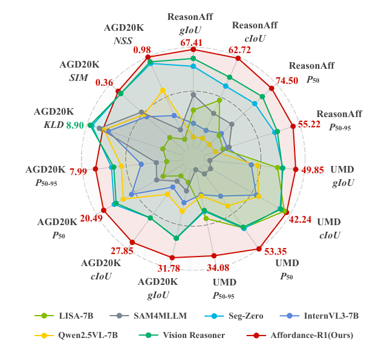
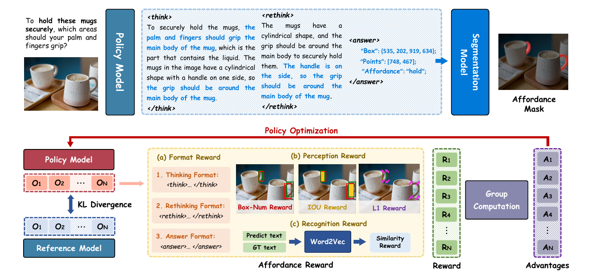
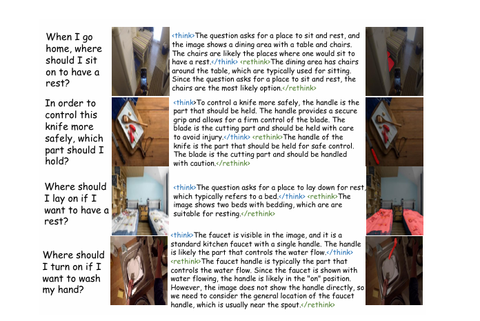

<div align="center">
<h1 align="center" >
 Affordance-R1: Reinforcement Learning for Generalizable Affordance Reasoning in Multimodal Large Language Model
</h1>


The repo is the official implementation of **"Affordance-R1: Reinforcement Learning for Generalizable Affordance Reasoning in Multimodal Large Language Model"**.   

Paper: [📖 Arxiv](https://arxiv.org/abs/2508.06206)   
Model: [🤗 Affordance-R1](https://huggingface.co/hqking/affordance-r1/tree/main)
Dataset: [🤗 HuggingFace](https://huggingface.co/datasets/hqking/affordance-R1)
Dataset: [🤗 Google Drive](https://drive.google.com/file/d/12piOxn3gf99fVnmgzalBvt6C9xJ9CCQ1/view?usp=share_link)

</div>


## News
[Dec 21th, 2025] 🔥 ReasonAff is coming! We have released the original dataset, and as stated in the appendix of the paper, we will filter the test data and provide a cleaner dataset soon, stay tuned!!!

[Aug 11th, 2025] 🔥 Affordance-R1 is coming! We have released the code !!!


Performance of Affordance-R1:
<div align=center>

</div>

> Affordance-R1 demonstrates extraordinary affordance reasoning ability and powerful generalization ability.

## Model
<div align=center>

</div>

> Affordance-R1 framework overview. The model processes queries through policy-based reasoning with < think > and < rethink > stages to generate affordance predictions. The policy optimization uses a sophisticated reward system
 comprising (a) format rewards for reasoning structure, (b) perception rewards for spatial accuracy (Box-Num, IOU, L1), and (c) recognition rewards for semantic similarity, enabling effective GRPO-based training for affordance reasoning

## Visualization on Web Image

<div align=center>

</div>

Affordance-R1 can  understand complex scenarios and shows good generalization.


## Installation
```bash
git clone https://github.com/hq-King/Affordance-R1.git
cd Affordance-R1
conda create -n Affordance-R1 python=3.12
conda activate Affordance-R1
pip install torch==2.6.0 torchvision==0.21.0
pip install -e .
pip install gensim
```

## Inference
Download pretrained models: [🤗 Affordance-R1](https://huggingface.co/hqking/affordance-r1/tree/main)
Modify the path in inference_scripts/infer.py and then run the following 
```bash
python inference_scripts/infer.py 
```
And you will get results like this:
<div align=center>

</div>

## Dataset
Download our ReasonAff datasrt [🤗 HuggingFace](https://huggingface.co/datasets/hqking/affordance-R1) ,[🤗 Google Drive](https://drive.google.com/file/d/12piOxn3gf99fVnmgzalBvt6C9xJ9CCQ1/view?usp=share_link)
As mentioned in the paper, we found there are some coarse ground truth in the original dataset, and we are trying to filter some dataset in the test split of the data, and we will release it soon! Stay tuned!
## Training
Download pretrained models:[Qwen2.5-VL-7B](https://huggingface.co/Qwen/Qwen2.5-VL-7B-Instruct) and [SAM2](https://huggingface.co/facebook/sam2-hiera-large)
Modify the path in `training_scripts/aff_r1.sh` and  `training_scripts/aff_r1.yaml`  and then run the following command to start training:
```bash
bash training_scripts/run_aff_r1.sh
```
After training, run the following command to merge the model"
```bash
python3 training_scripts/model_merger.py --local_dir [path_to_your_actor_checkpoint]
```

## Evaluation  
Download the dataset, and modify the dataset path in the following file
```bash
bash evaluation_scripts/eval_aff_r1.sh
```


## Acknowledgement
We would like to thank the following repos for their great work: 

- This work is built upon the [seg_zero](https://github.com/dvlab-research/Seg-Zero) and [veRL](https://github.com/volcengine/verl).
- This work utilizes models from  [Qwen2-VL](https://huggingface.co/Qwen/Qwen2-VL-2B-Instruct), [Qwen2.5-VL](https://huggingface.co/Qwen/Qwen2.5-VL-7B-Instruct) and [SAM2](https://huggingface.co/facebook/sam2-hiera-large). 

## Acknowledgement
```
@article{wang2025affordance,
  title={Affordance-R1: Reinforcement Learning for Generalizable Affordance Reasoning in Multimodal Large Language Model},
  author={Wang, Hanqing and Wang, Shaoyang and Zhong, Yiming and Yang, Zemin and Wang, Jiamin and Cui, Zhiqing and Yuan, Jiahao and Han, Yifan and Liu, Mingyu and Ma, Yuexin},
  journal={arXiv preprint arXiv:2508.06206},
  year={2025}
}
```

